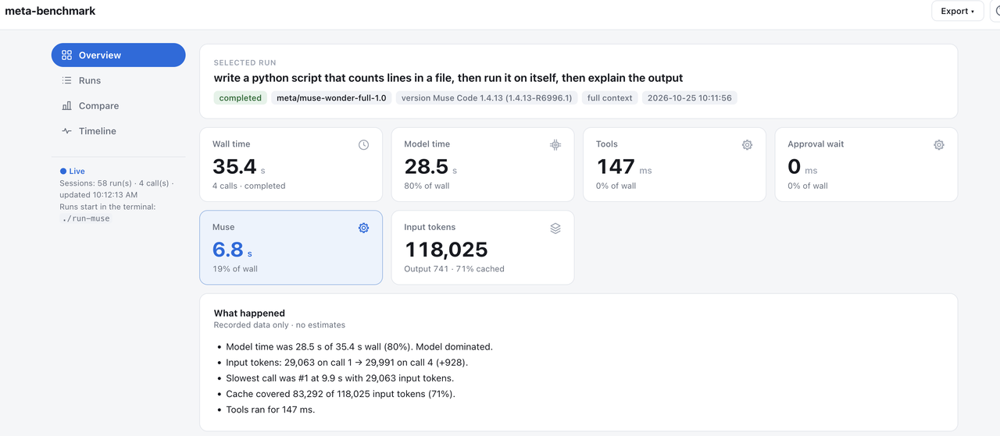
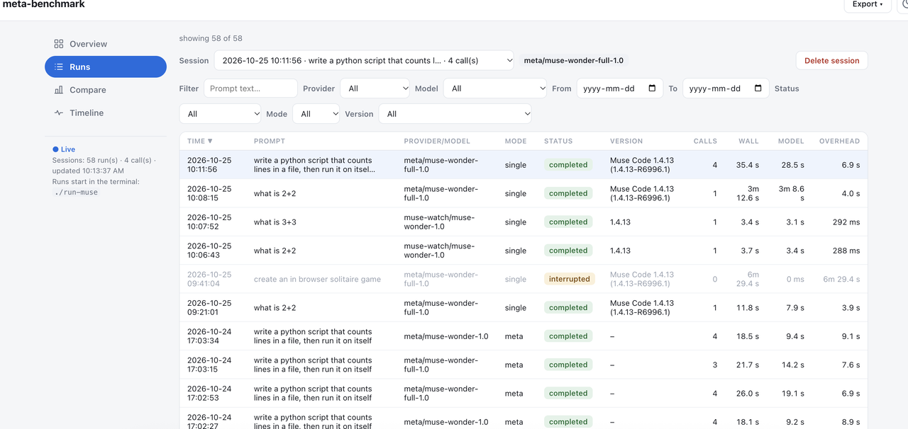
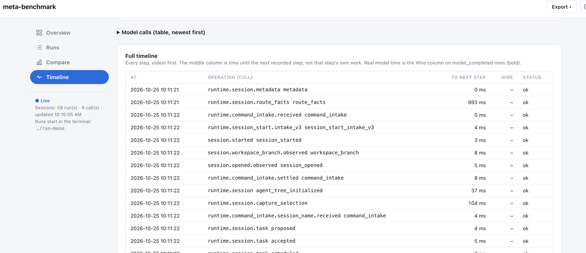

# meta-benchmark

A stopwatch for Muse Code, Meta's coding agent. Give it a prompt and it shows where the time went: how long the model spent thinking, and how much was Muse's own overhead. One command, runs locally, nothing to install. It tells you which part is slow before you guess.

You can also compare models on the same prompt: two Meta models, or Meta against Claude.



## Requirements

Python 3 and macOS or Linux. No packages to install. Muse Code. Claude Code runs also need the `claude` CLI.

## Quick start

```sh
git clone https://github.com/danphillips-cloud/meta-benchmark.git
cd meta-benchmark
muse login    # first time only
./run-muse
```

## API keys

Muse runs need no key. Claude Code and raw API runs read keys from a `.env` file in the repo root, which is gitignored:

```sh
MODEL_API_KEY=your-meta-key
ANTHROPIC_API_KEY=your-anthropic-key
```

## How to use

**In the terminal**

1. Run `./run-muse`. The results page opens at http://127.0.0.1:8765.
2. Type a prompt at `muse>` and press Enter. Each prompt is one run.
3. The reply prints with one summary line: wall time, model time, tokens.
4. `Ctrl+C` stops a run and records it as `interrupted`. `/quit` exits.

**On the page**

- **Live.** The page refreshes every 2 seconds and follows a run in progress, so model calls show up as they finish.
- **Overview** shows one run: wall time split into model, tools, approval wait and Muse, a plain-words "What happened" summary, a chart of each model call, and your usual time for the same prompt.
- **Runs** logs every run. Sort and filter it, then click a row to open that run in Overview.
- **Compare** shows medians for a compare set, with the fastest marked.
- **Timeline** lists the model calls and every step Muse recorded, in order.
- **Export** saves the selected run as CSV or JSON.





## Usage

```sh
./run-muse "write a python script that counts lines in a file, then run it on itself"
./run-muse --minimal "what is 2+2"                # controlled context
./run-muse --watch                                # time your own Muse session, read-only
```

| Mode | Command |
|---|---|
| Single (default) | `./run-muse` |
| Meta vs Meta | `./run-muse --compare meta` |
| Meta vs Claude | `./run-muse --compare claude` |
| Custom | `./run-muse --compare custom` |

Meta vs Claude uses API keys and is billed per token. Single and Meta vs Meta use the Muse subscription.

In the loop, `/mode meta`, `/mode claude`, and `/mode single` switch mode. `/help` lists commands. The prompt shows the mode, for example `muse[meta]>`.

## Reading the numbers

**Wall** is the whole run. It splits into **Model** (the model thinking), **Tools** (commands Muse ran), **Approval wait**, and **Muse** (everything else Muse did). All four come from timestamps in Muse's own log. A dash means the log didn't record it.

Claude Code doesn't report per-call time, so its per-call columns are blank and Model uses its API time.

## Advanced

| `--provider` | Runs |
|---|---|
| `meta` (default) | Muse Code |
| `claude-code` | Claude Code headless, `--bare` |
| `anthropic` | One raw Messages API call |

For `claude-code` and `anthropic`, a `muse-*` model goes to Meta's API and anything else goes to Anthropic. Meta's API serves `muse-wonder-1.0`.

`--compare meta --repeat N` runs N rounds, alternating the order each round.

| Variable | Default | What it does |
|---|---|---|
| `MODEL_API_KEY` | unset | Key for `muse-*` models on Meta's API |
| `ANTHROPIC_API_KEY` | unset | Key for Claude models |
| `COMPARE_META` | `meta:muse-wonder-full-1.0,meta:muse-wonder-1.0` | Pairs for `--compare meta` |
| `COMPARE_CLAUDE` | `claude-code:muse-wonder-1.0,claude-code:claude-sonnet-5-5` | Pairs for `--compare claude` |
| `COMPARE_MODELS` | `meta:muse-wonder-1.0,claude-code:muse-wonder-1.0,claude-code:claude-sonnet-5-5` | Pairs for `--compare custom` |
| `BENCH_CLAUDE_MODEL` | `claude-sonnet-5-5` | Default model for `claude-code` and `anthropic` |
| `META_BASE_URL` | `https://api.meta.ai` | Meta API endpoint |
| `ANTHROPIC_MAX_TOKENS` | `8192` | Output cap for `anthropic` runs |
| `PORT` | `8765` | Results page port |
| `RUN_MUSE_NO_UI` | unset | `1` skips the web page |

Run data stays in `muse-runs/`, which is gitignored. The page is served on `127.0.0.1` only.

## Tests

```sh
python3 test_tool.py
```

## Developing the UI

The page is React, built into `web/app.js`, which is committed. Users don't need Node. To change the UI, edit `frontend/src`, then rebuild and commit `web/` with your change:

```sh
cd frontend
npm ci
npm test
npm run build
```

## Licence

[MIT](LICENSE). Unofficial tool, not affiliated with Meta.
