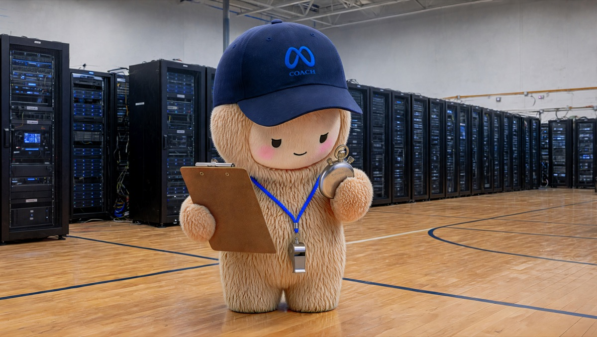
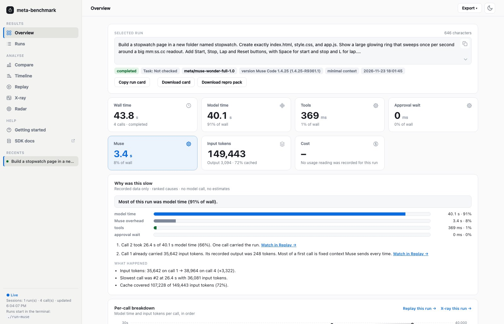
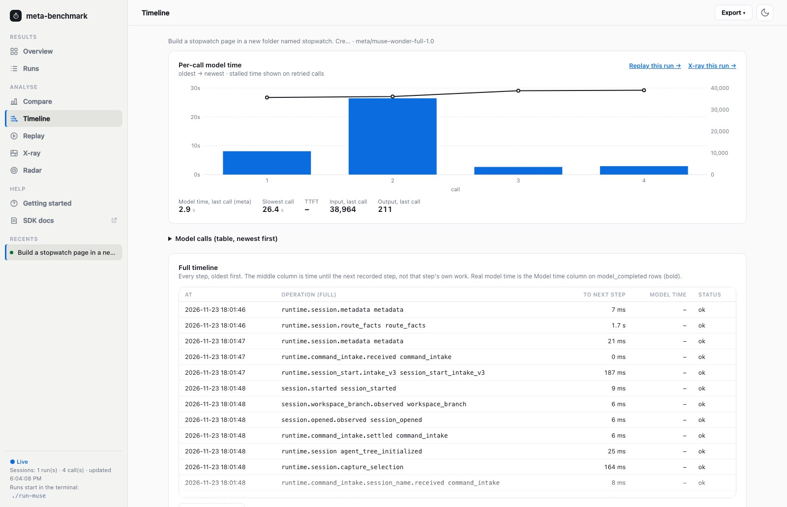
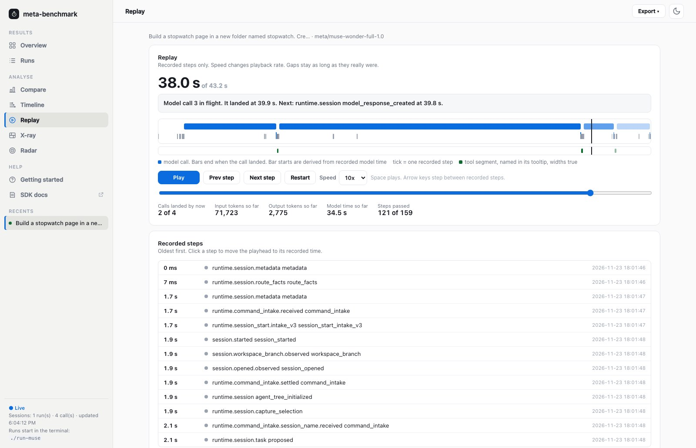
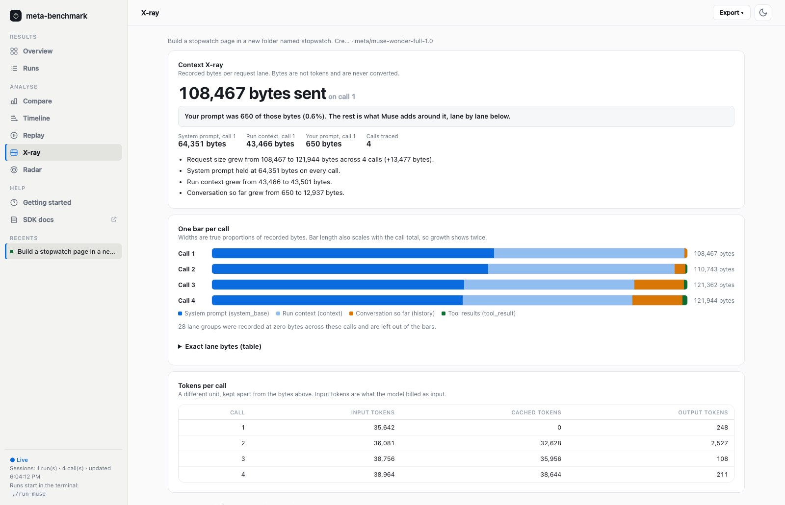
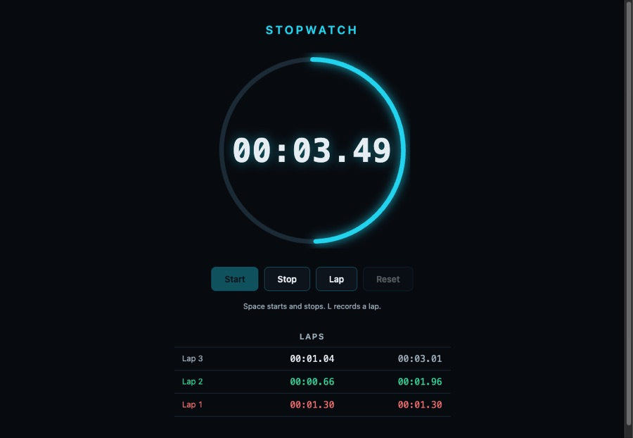

# meta-benchmark

A local benchmark tool for Muse Code, Meta's coding agent. Give it a prompt and it records where the time went, what the run cost, and how it stacks up, all on a results page that runs on your machine.

I built this for the [Meta AI Developer Hackathon](https://cerebralvalley.ai/e/meta-ai-developer-hackathon).



- **Time.** Where each run's time went: model, tools, approval wait, and Muse's own overhead.
- **Cost.** In the unit you pay in: how much of your Muse plan's limits a run used, or dollars for API runs.
- **Compare.** Meta models side by side, or Meta against Anthropic, on the same prompt.
- **Replay and X-ray.** Watch a run back on its recorded clock, and see how the context grew call by call.
- **Radar.** A fixed set of prompts tracked across Muse versions, so you see when an update makes things slower.

Start with the [user guide](docs/user-guide.md) for an offline first run. Use the [glossary](docs/glossary.md) to look up a dashboard label or calculation. The [prompt gallery](docs/getting-started.md) has five tasks you can try, and the [Codex guide](docs/openai.md) covers OpenAI setup and three-way comparisons.

<picture>
  <source media="(prefers-color-scheme: dark)" srcset="docs/images/overview-dark.jpg">
  
</picture>

## Requirements

Python 3.11 or newer on macOS or Linux, and Muse Code. Windows works through WSL. Native Windows Python is not supported. Claude Code and Codex runs need their respective CLIs. The direct API route needs only Python and a key.

## Getting started

### 1. Clone and sign in

```sh
git clone https://github.com/danphillips-cloud/meta-benchmark.git
cd meta-benchmark
muse login    # first time only
```

The stopwatch examples use Muse subscription access. The default model, Wonder Full, requires a Power Usage or Maximum Usage plan. For another plan, choose an available model with `--model`. See [setup and first run](docs/user-guide.md#set-up).

### 2. Run one real test

Start with a one-shot prompt. One-shot means everything the agent needs sits in a single prompt, with no follow-up. This one builds a working stopwatch. The first line saves the prompt in a shell variable, so later steps can reuse it.

```sh
PROMPT="Build a stopwatch page in a new folder named stopwatch. Create exactly index.html, style.css, and app.js. Show a large glowing ring that sweeps once per second around a big mm:ss.cc readout. Add Start, Stop, Lap and Reset buttons, with Space for start and stop and L for lap. List laps newest first, with the fastest lap in green and the slowest in red. Use a dark theme with one cyan accent. Use no external URLs, fonts, images, libraries, or build step. It must work by opening index.html from the filesystem. Run node --check app.js if node is available, and fix any failure. Final reply under 100 words with the controls and the check result."
./run-muse --minimal "$PROMPT"
```

The prompt is built to be checkable in one pass:

- **Goal first.** One small app in a named folder.
- **Exact files.** `index.html`, `style.css` and `app.js`, nothing else.
- **Behaviour you can test.** Buttons, two keys, and lap colours you can see.
- **Hard limits.** No external URLs or libraries. It runs from the filesystem.
- **A self-check.** The agent runs `node --check` and reports the result.

`--minimal` suppresses reminders and foreign personal context. Repeats still vary. It doesn't make the request much smaller. Muse's own context still rides along: call 1 of this run carried 29,455 input tokens.

The terminal prints each model call as it finishes, then the reply with one summary line. This example is from Muse Code 1.4.14, recorded on 2026-11-01:

```text
[meta/muse-wonder-full-1.0] wall 93969 ms · model 88464 ms · in 544500 · out 6258 · 15 call(s) · Muse plan: used under 1% of short-term limit (0→0%), under 1% of weekly limit (58→58%) · completed
```

Your numbers will differ. The split is the point.

### 3. Read it on the page

Follow the local UI address printed in the terminal.

Overview, above, gives the time split and a plain-words account of where the time went.

**Timeline** charts each model call in order, with input tokens as the line, then lists every recorded step.

<picture>
  <source media="(prefers-color-scheme: dark)" srcset="docs/images/timeline-dark.jpg">
  
</picture>

**Replay** plays the run back on its recorded clock. Calls land where they landed.

<picture>
  <source media="(prefers-color-scheme: dark)" srcset="docs/images/replay-dark.jpg">
  
</picture>

**X-ray** shows what Muse sent on each call. Here the prompt was 650 bytes of an 85,386 byte first request.

<picture>
  <source media="(prefers-color-scheme: dark)" srcset="docs/images/xray-dark.jpg">
  
</picture>

Then check the work itself. In this example the generated folder sits in the run's own workspace, under `muse-runs/<run id>/workspace/stopwatch/`, so nothing in the repo changes. Open its `index.html`, press Space, then L a few times. The fastest lap should turn green and the slowest red.



Completed means the process ended cleanly. It doesn't mean the stopwatch works, which is why this step has you press the buttons. A manifest can add checks on the result. See [Checking task results](#checking-task-results).

### 4. Run it again

One run is an anecdote. Two recorded runs of this exact prompt, eight minutes apart, used the same model and the same Muse version. The first run took 6 calls and 60.9 s. The second took 15 calls and 94.0 s, 54% longer for the same work. Neither number is the answer. The pattern across repeats is.

```sh
./run-muse --minimal "$PROMPT"
```

Run it three more times, in the same terminal so `$PROMPT` is still set. From the fourth run on, Overview measures each new run against your usual for this prompt: the median of your earlier runs with the same model and context. The Wall and Model cards gain a "usual" figure, and Why was this slow opens with how far off it the run landed. One recorded example reads "Wall 9.4 s against a usual 7.0 s for this prompt (median of 6 earlier runs, +34%)". On Runs, type `stopwatch` in the filter to line up every attempt.

Then put the Meta models on the same work:

```sh
./run-muse --minimal --compare meta --repeat 3 "$PROMPT"
```

`--compare meta` runs four Meta models per round: `muse-wonder-1.0`, `muse-wonder-full-1.0`, `muse-spark-1.3` and `muse-spark-1.2`. With `--repeat 3` that is 12 full runs of the prompt on your Muse plan. To compare fewer, name the legs yourself:

```sh
COMPARE_META=meta:muse-wonder-1.0,meta:muse-spark-1.3 ./run-muse --minimal --compare meta --repeat 3 "$PROMPT"
```

Compare shows medians across completed runs and a sample size for each metric. Times and output speed also show their observed ranges when available.

The [getting started guide](docs/getting-started.md) has five longer one-shot app prompts, plus a frame for writing your own.

## Reading the numbers

A dash means no usable measurement for that field. Read each number in its provider's context.

### Time

Wall measures elapsed time around the process or direct request. Model, Tools, Approval wait and Muse have different sources and can be missing independently. [Time measurements](docs/glossary.md#time-measurements)

### Tokens

Input and output count the tokens recorded by the harness. Last-call and whole-run counts can differ substantially when later calls resend earlier context. [Calls and tokens](docs/glossary.md#calls-and-tokens)

### Cost

Muse subscription runs show movement in plan limits when recorded. Paid routes can show a reported or computed USD cost. Codex cost stays unknown. [Cost and allowance](docs/glossary.md#cost-and-allowance)

### Compare and medians

Medians use completed runs and count observations separately for each metric. Always read task checks alongside timing. [Compare repeated runs](docs/user-guide.md#repeat-and-compare) · [Usual and fastest](docs/glossary.md#usual-fastest-and-change)

### Imported turns

Use `--watch` for an interactive Muse session or `--retro` to import earlier turns. A missing terminal outcome can leave a turn unknown. [Terminal workflows](docs/user-guide.md#use-the-terminal)

## The page

Start in Overview to inspect one result. Use Runs to find attempts, Compare to line them up, Timeline and Replay to inspect recorded steps, X-ray to explore request sizes, and Radar to compare harness versions. The guide covers each view and what its exports include. [Read the dashboard](docs/user-guide.md#read-the-dashboard)

## Usage

Run one quoted prompt or start `./run-muse` for the prompt loop. Use `--compare meta`, `claude` or `custom` to launch a set. The configured legs determine which accounts are used and whether calls incur API charges. [Commands and options](docs/user-guide.md#use-the-terminal) · [Presets and repeats](docs/user-guide.md#repeat-and-compare)

### Manifests

A manifest lists named tasks, settings and optional checks. Preview it with `./run-muse --manifest model-benchmark.json --dry-run`. [Write a manifest, set budgets and resume](docs/user-guide.md#run-a-suite-and-check-the-work)

## Model benchmark

`model-benchmark.json` is a ready-made manifest of six short prompts, each with a check on the answer. Run it once per model, then compare the models on the page.

```sh
./run-muse --manifest model-benchmark.json --dry-run                   # list what would run
./run-muse --manifest model-benchmark.json --model muse-wonder-1.0
./run-muse --manifest model-benchmark.json --model muse-spark-1.3
```

| Prompt | What it shows |
|---|---|
| `ping` | Startup cost, with almost no thinking |
| `format` | Following an exact output format |
| `clock` | Short reasoning, where a quick guess is wrong |
| `count` | Careful multi-step counting |
| `essay` | Output speed on a long reply |
| `primes-code` | Tool use: write code, run it, report the result |

Each prompt runs 3 times, so one pass is 18 runs on your Muse plan. `--model` fills in entries for the selected provider that name no model. An entry with its own `model` keeps it. With `--resume`, add `--fresh` when you switch model, or the entries the last model completed are skipped.

On Runs, type part of a prompt in the filter, such as `clock shows`, and tick runs to compare them. A run that finishes with the wrong answer shows completed with failed checks, and the suite exits with code 1.

## Checking task results

A completed run can still fail its task checks. Inspect the reply, use configured checks for concrete requirements and try the generated work yourself. [Worked example and check rules](docs/user-guide.md#run-a-suite-and-check-the-work)

## Providers and keys

The default `meta` route uses Muse Code. Use `echo` for an offline exercise, `claude-code` for a headless agent through an API key, `anthropic` for a direct Messages request or `codex` for the saved Codex CLI login. [Provider and billing table](docs/user-guide.md#choose-a-provider-and-model) · [Codex login](docs/openai.md#sign-in-and-run)

## Configuration

| Variable | Default | What it does |
|---|---|---|
| `MODEL_API_KEY` | unset | Key for `muse-*` models on Meta's API |
| `ANTHROPIC_API_KEY` | unset | Key for Claude models |
| `MUSE_MODEL` | `muse-wonder-full-1.0` | Default model for single runs |
| `MUSE_PROVIDER` | `meta` | Default provider for single runs |
| `COMPARE_META` | `meta:muse-wonder-1.0,meta:muse-wonder-full-1.0,meta:muse-spark-1.3,meta:muse-spark-1.2` | Pairs for `--compare meta` |
| `COMPARE_CLAUDE` | `claude-code:muse-wonder-1.0,claude-code:claude-sonnet-5-5` | Pairs for `--compare claude` |
| `COMPARE_MODELS` | `meta:muse-wonder-1.0,claude-code:muse-wonder-1.0,claude-code:claude-sonnet-5-5` | Pairs for `--compare custom` |
| `BENCH_CODEX_MODEL` | unset | Codex model ID when no explicit model is supplied |
| `BENCH_CLAUDE_MODEL` | `claude-sonnet-5-5` | Default model for `claude-code` and `anthropic` |
| `BENCH_PRICING` | unset | Your rates as JSON, USD per million tokens per model, used to work out run cost |
| `META_BASE_URL` | `https://api.meta.ai` | Meta API endpoint |
| `ANTHROPIC_BASE_URL` | `https://api.anthropic.com` | Anthropic API endpoint |
| `MUSE_SESSIONS_DIR` | `~/.local/share/muse/sessions` | Where Muse writes session logs |
| `ANTHROPIC_MAX_TOKENS` | `8192` | Output cap for `anthropic` runs |
| `PORT` | `8765` | Results page port. If another app holds it, the launcher says so and runs carry on without the page |
| `RUN_MUSE_NO_UI` | unset | Any value skips the web page. Use `1` |

Run data stays in `muse-runs/`, which is gitignored. The page is served on `127.0.0.1` only.

## Development

Run the Python tests:

```sh
python3 tests/test_tool.py
```

The page is React, built into `web/app.js`, which is committed. Users don't need Node. To change the UI, edit `frontend/src`, then rebuild and commit `web/` with your change:

```sh
cd frontend
npm ci
npm test
npm run build
```

## Licence

[MIT](LICENSE). Unofficial tool, not affiliated with Meta.
