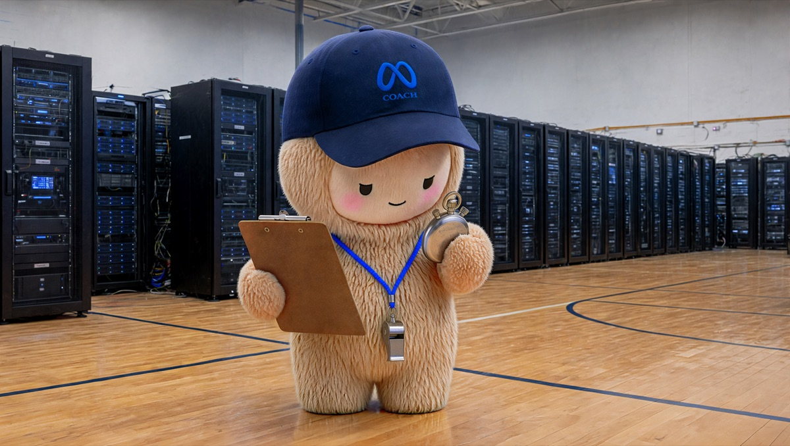
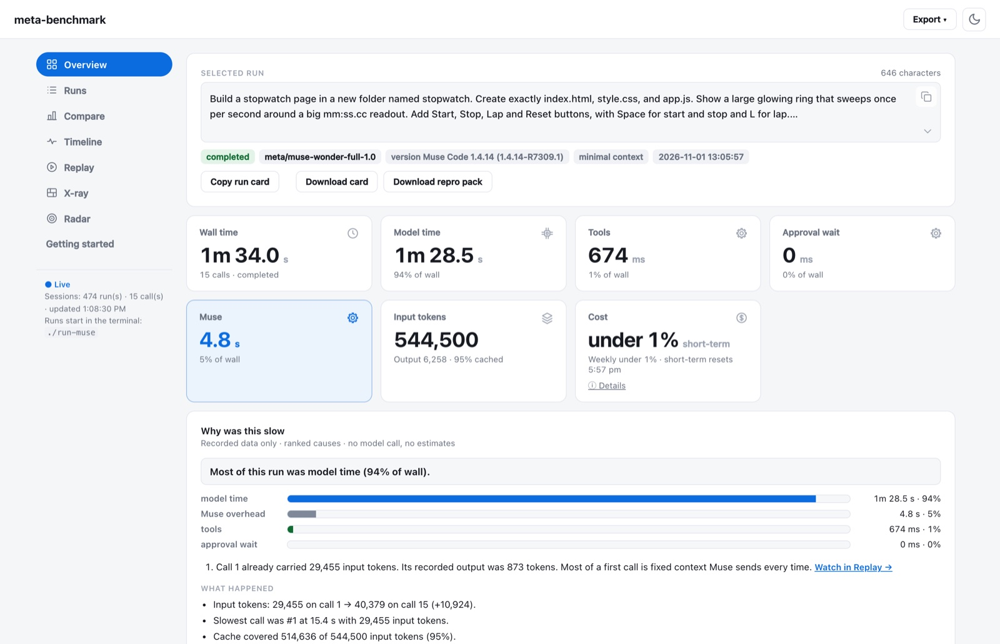
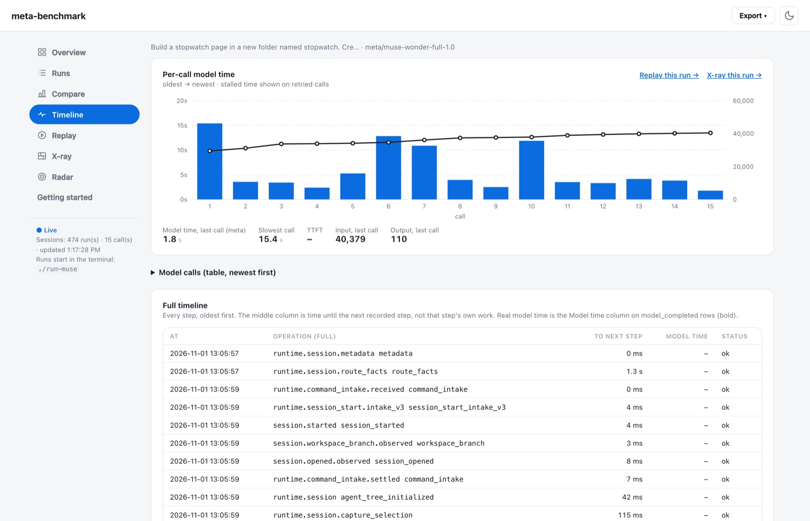
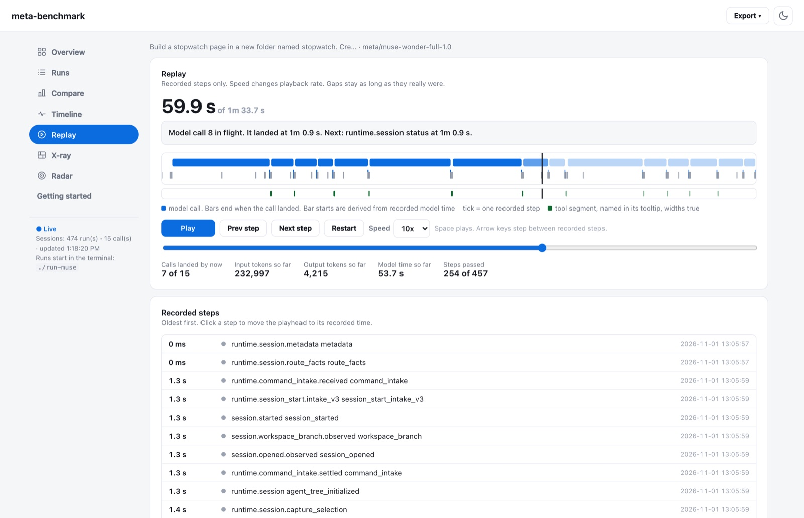
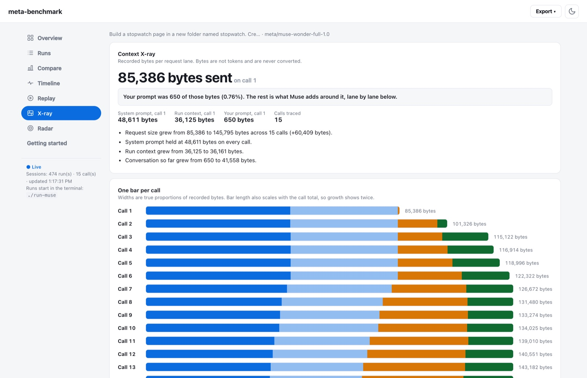
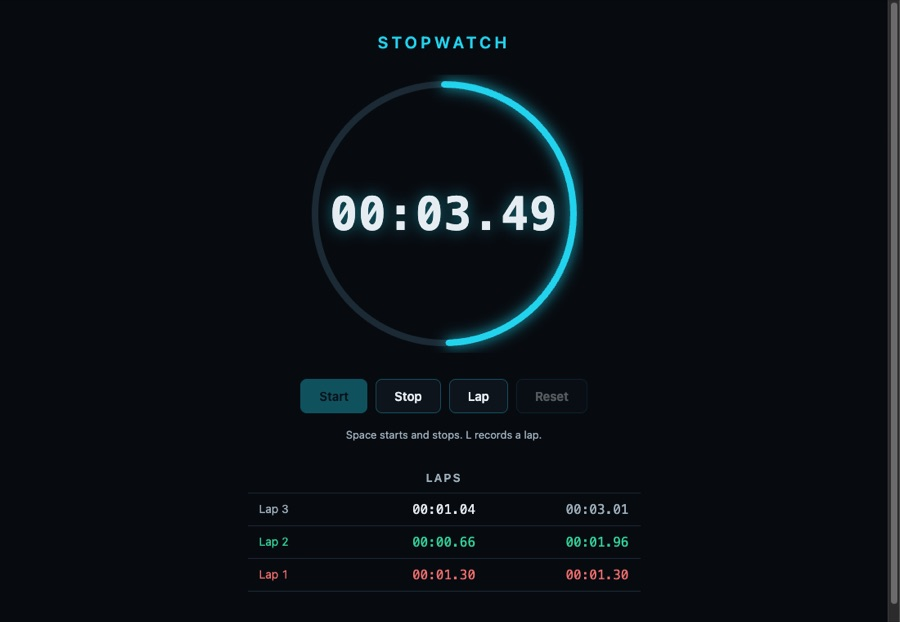

# meta-benchmark

A local benchmark tool for Muse Code, Meta's coding agent. Give it a prompt and it records where the time went, what the run cost, and how it stacks up, all on a results page that runs on your machine.

I built this for the [Meta AI Developer Hackathon](https://cerebralvalley.ai/e/meta-ai-developer-hackathon).



- **Time.** Where each run's time went: model, tools, approval wait, and Muse's own overhead.
- **Cost.** In the unit you pay in: how much of your Muse plan's limits a run used, or dollars for API runs.
- **Compare.** Two Meta models, or Meta against Anthropic, on the same prompt.
- **Replay and X-ray.** Watch a run back on its recorded clock, and see how the context grew call by call.
- **Radar.** A fixed set of prompts tracked across Muse versions, so you see when an update makes things slower.

Nothing is estimated. If a number wasn't recorded, the page shows a dash.

<picture>
  <source media="(prefers-color-scheme: dark)" srcset="docs/images/overview-dark.jpg">
  
</picture>

## Requirements

Python 3.9 or newer on macOS or Linux, and Muse Code. Windows works through WSL. Native Windows Python is not supported. Claude Code runs also need the `claude` CLI.

## Getting started

### 1. Clone and sign in

```sh
git clone https://github.com/danphillips-cloud/meta-benchmark.git
cd meta-benchmark
muse login    # first time only
```

That is the whole install for everything below. These runs use a Muse subscription. No API key, no Node.

### 2. Run one real test

Start with a one-shot prompt. One-shot means everything the agent needs sits in a single prompt, with no follow-up. This one builds a working stopwatch.

```sh
./run-muse --minimal "Build a stopwatch page in a new folder named stopwatch. Create exactly index.html, style.css, and app.js. Show a large glowing ring that sweeps once per second around a big mm:ss.cc readout. Add Start, Stop, Lap and Reset buttons, with Space for start and stop and L for lap. List laps newest first, with the fastest lap in green and the slowest in red. Use a dark theme with one cyan accent. Use no external URLs, fonts, images, libraries, or build step. It must work by opening index.html from the filesystem. Run node --check app.js if node is available, and fix any failure. Final reply under 100 words with the controls and the check result."
```

The prompt is built to be checkable in one pass:

- **Goal first.** One small app in a named folder.
- **Exact files.** `index.html`, `style.css` and `app.js`, nothing else.
- **Behaviour you can test.** Buttons, two keys, and lap colours you can see.
- **Hard limits.** No external URLs or libraries. It runs from the filesystem.
- **A self-check.** The agent runs `node --check` and reports the result.

`--minimal` drops reminders and personal context, so a repeat of the same command measures the same work. It doesn't make the request much smaller. Muse's own context still rides along: call 1 of this run carried 29,455 input tokens.

The terminal prints each model call as it finishes, then the reply with one summary line. I recorded this run on 2026-11-01 with Muse Code 1.4.14:

```text
[meta/muse-wonder-full-1.0] wall 93969 ms · model 88464 ms · in 544500 · out 6258 · 15 call(s) · Muse plan: used under 1% of short-term limit (0→0%), under 1% of weekly limit (58→58%) · completed
```

Your numbers will differ. The split is the point.

### 3. Read it on the page

Open http://127.0.0.1:8765.

Overview, above, gives the time split and a plain-words account of where the time went.

**Timeline** charts each model call in order, with input tokens as the line, then lists every recorded step.

<picture>
  <source media="(prefers-color-scheme: dark)" srcset="docs/images/timeline-dark.jpg">
  
</picture>

**Replay** plays the run back on its recorded clock. Calls land where they landed.

<picture>
  <source media="(prefers-color-scheme: dark)" srcset="docs/images/replay-dark.jpg">
  
</picture>

**X-ray** shows what Muse sent on each call. Here the prompt was 650 bytes of an 85,386 byte first request.

<picture>
  <source media="(prefers-color-scheme: dark)" srcset="docs/images/xray-dark.jpg">
  
</picture>

Then check the work itself. The reply links the new folder. It sits in the run's own workspace, under `muse-runs/<run id>/workspace/stopwatch/`, so nothing in the repo changes. Open its `index.html`, press Space, then L a few times. The fastest lap should turn green and the slowest red.



This tool says where the time went. It does not say the work is right. That part is yours.

### 4. Run it again

One run is an anecdote. I ran this exact prompt twice, eight minutes apart, with the same model and the same Muse version. The first run took 6 calls and 60.9 s. The second took 15 calls and 94.0 s, 54% longer for the same work. Neither number is the answer. The pattern across repeats is.

```sh
./run-muse --minimal "Build a stopwatch page in a new folder named stopwatch. Create exactly index.html, style.css, and app.js. Show a large glowing ring that sweeps once per second around a big mm:ss.cc readout. Add Start, Stop, Lap and Reset buttons, with Space for start and stop and L for lap. List laps newest first, with the fastest lap in green and the slowest in red. Use a dark theme with one cyan accent. Use no external URLs, fonts, images, libraries, or build step. It must work by opening index.html from the filesystem. Run node --check app.js if node is available, and fix any failure. Final reply under 100 words with the controls and the check result."
```

Run it three more times. From the fourth run on, Overview measures each new run against your usual for this prompt: the median of your earlier runs with the same model and context. The Wall and Model cards gain a "usual" figure, and Why was this slow opens with how far off it the run landed. One recorded example reads "Wall 9.4 s against a usual 7.0 s for this prompt (median of 6 earlier runs, +34%)". On Runs, type `stopwatch` in the filter to line up every attempt.

Then put two Meta models on the same work:

```sh
./run-muse --minimal --compare meta --repeat 3 "Build a stopwatch page in a new folder named stopwatch. Create exactly index.html, style.css, and app.js. Show a large glowing ring that sweeps once per second around a big mm:ss.cc readout. Add Start, Stop, Lap and Reset buttons, with Space for start and stop and L for lap. List laps newest first, with the fastest lap in green and the slowest in red. Use a dark theme with one cyan accent. Use no external URLs, fonts, images, libraries, or build step. It must work by opening index.html from the filesystem. Run node --check app.js if node is available, and fix any failure. Final reply under 100 words with the controls and the check result."
```

Each round is two full runs of the prompt. The Compare page reads medians over the rounds, so one slow call cannot carry the result.

Ready for a longer build? The [getting started guide](docs/getting-started.md) has five one-shot app prompts, plus a frame for writing your own.

## Reading the numbers

**Wall** is the whole run. It splits into **Model** (the model thinking), **Tools** (commands Muse ran), **Approval wait**, and **Muse** (everything else Muse did). All four come from timestamps in Muse's own log. A dash means the log didn't record it.

Claude Code doesn't report per-call time, so its per-call columns are blank and Model uses its API time.

**Cost** shows on Overview, Runs and Compare, always in the unit the run is billed in. Your Muse plan has two usage limits, a short-term one and a weekly one. Subscription runs show how much of each limit moved while they ran, as "+N% short-term · +N% weekly". The start reading comes from `muse usage` before the run launches. The end reading comes from the run stream. Overview shows the readings before and after in a small table, plus the clock time the short-term limit resets. Muse's own `muse usage` calls the short-term one Window. Other Muse use at the same time counts too, and the hover text says so. Muse counts whole percents. A run that moved a limit by less than one point shows under 1%. A limit reset mid-run, or a missing reading, shows a dash with the reason.

Paid runs show USD. Claude models keep the cost Claude Code reports. `muse-wonder-1.0` runs on the `anthropic` and `claude-code` providers are priced from their recorded tokens at [Meta's published list](https://dev.meta.ai/docs/pricing-rate-limits), as fetched on 2026-10-31, and marked "at Meta list". Input, cached and output tokens all count. Any missing count shows a dash. The figure Claude Code itself attaches to `muse-*` models comes from Anthropic's list. That is not a Meta price, so it stays hidden. Set your own rates with `BENCH_PRICING` in `.env`, or `pricing` in a manifest, as USD per million tokens per model, and your rates win over the list. A cost at your rates is marked "at your rates" and counts input and output tokens only. Suite cost budgets count list costs too. Nothing is ever estimated.

> **Note:** Meta publishes no per-token price for `muse-wonder-full-1.0`. Runs on it through the `anthropic` or `claude-code` providers show a dash for cost. Subscription runs on it still show plan usage. If you have your own rate for it, set it in `BENCH_PRICING`.

## The page

The page refreshes every 2 seconds and follows a run in progress, so model calls show up as they finish.

On your first visit a short walkthrough opens and points at each part of the page in turn. After that it lives behind Getting started in the sidebar.

- **Overview** shows one run: wall time split into model, tools, approval wait and Muse, a plain-words "What happened" summary, a chart of each model call, and your usual time for the same prompt.
- **Runs** logs every run. Sort and filter it, then click a row to open that run in Overview.
- **Compare** shows medians for a compare set, with the fastest marked.
- **Timeline**, **Replay** and **X-ray** are shown in [step 3](#3-read-it-on-the-page).
- **Radar** shows median wall time per prompt across Muse versions, and the change between the two newest versions with enough runs.
- **Export** saves the selected run as CSV or JSON.

## Usage

| Mode | Command |
|---|---|
| Single (default) | `./run-muse` |
| Meta vs Meta | `./run-muse --compare meta` |
| Meta vs Claude | `./run-muse --compare claude` |
| Custom | `./run-muse --compare custom` |

Single and Meta vs Meta use your Muse subscription. Meta vs Claude bills your API keys per token. So does Custom by default, because its default legs use Claude Code.

Every paid run prints `Paid run: uses MODEL_API_KEY` (or `ANTHROPIC_API_KEY`) before it starts, and stops after 5 minutes. Claude Code runs print a line as each call lands.

`--compare meta --repeat N` runs N rounds, alternating the order each round.

`./run-muse --watch` times your own interactive Muse session, read-only. Run Muse normally in another terminal.

In the prompt loop, `/mode meta`, `/mode claude` and `/mode single` switch mode, and the prompt shows it, for example `muse[meta]>`. `/help` lists commands. `Ctrl+C` stops a run and records it as `interrupted`. `/quit` exits.

### Manifests

Stage a whole benchmark in one JSON file, then run it in one go.

```sh
./run-muse --manifest bench.json --dry-run   # list what would run, run nothing
./run-muse --manifest bench.json --resume    # run it, keep progress in bench.state.json
```

`--suite` is the older name for the same thing, and `golden-prompts.json` still works as before. The file holds a `prompts` list and an optional `settings` block.

```json
{
  "settings": {
    "concurrency": 1,
    "timeout_seconds": 1800,
    "max_cost_usd": 10.0,
    "max_runtime_seconds": 3600,
    "pricing": {"input_per_mtok": 4.0, "output_per_mtok": 20.0}
  },
  "prompts": [
    {"name": "sky", "prompt": "Why is the sky blue?", "minimal": true},
    {"name": "big", "file": "prompts/big.md", "timeout_seconds": 3600, "skip": false}
  ]
}
```

Each entry needs a unique `name` and either a `prompt` or a `file`, relative to the manifest. `provider`, `model`, `minimal`, `skip` and `timeout_seconds` are optional per entry. The `--timeout` flag beats a per entry timeout, which beats the settings timeout, which beats the provider default.

Budgets stop new entries from starting. They never kill a run in flight, because a run's cost is only known when it ends. The next entry timeout also shrinks to fit the runtime budget left. `--dry-run` prints every entry, marks paid ones, and says what the budgets count. Read it before a big paid run.

`--resume` writes progress to a state file beside the manifest. Stop partway, run the same command again, and completed entries are skipped under the same suite. Failed and timed out entries run again. Add `--fresh` to ignore saved progress. Without `--resume` nothing changes from before, and no state file is written. The runner reads the manifest once at the start, so edit it only between runs.

## Providers and keys

| `--provider` | Runs |
|---|---|
| `meta` (default) | Muse Code |
| `claude-code` | Claude Code headless, `--bare` |
| `anthropic` | One raw Messages API call |
| `echo` | No model. Echoes the prompt, free, for trying the page offline |

For `claude-code` and `anthropic`, a `muse-*` model goes to Meta's API and anything else goes to Anthropic. Meta's API serves `muse-wonder-1.0`.

Only Claude Code and raw API runs need keys. Put them in a `.env` file in the repo root. It's gitignored.

```sh
MODEL_API_KEY=your-meta-key
ANTHROPIC_API_KEY=your-anthropic-key
```

## Configuration

| Variable | Default | What it does |
|---|---|---|
| `MODEL_API_KEY` | unset | Key for `muse-*` models on Meta's API |
| `ANTHROPIC_API_KEY` | unset | Key for Claude models |
| `MUSE_MODEL` | `muse-wonder-full-1.0` | Default model for single runs |
| `MUSE_PROVIDER` | `meta` | Default provider for single runs |
| `COMPARE_META` | `meta:muse-wonder-full-1.0,meta:muse-wonder-1.0` | Pairs for `--compare meta` |
| `COMPARE_CLAUDE` | `claude-code:muse-wonder-1.0,claude-code:claude-sonnet-5-5` | Pairs for `--compare claude` |
| `COMPARE_MODELS` | `meta:muse-wonder-1.0,claude-code:muse-wonder-1.0,claude-code:claude-sonnet-5-5` | Pairs for `--compare custom` |
| `BENCH_CLAUDE_MODEL` | `claude-sonnet-5-5` | Default model for `claude-code` and `anthropic` |
| `BENCH_PRICING` | unset | Your rates as JSON, USD per million tokens per model, used to work out run cost |
| `META_BASE_URL` | `https://api.meta.ai` | Meta API endpoint |
| `ANTHROPIC_BASE_URL` | `https://api.anthropic.com` | Anthropic API endpoint |
| `MUSE_SESSIONS_DIR` | `~/.local/share/muse/sessions` | Where Muse writes session logs |
| `ANTHROPIC_MAX_TOKENS` | `8192` | Output cap for `anthropic` runs |
| `PORT` | `8765` | Results page port. If another app holds it, the launcher says so and runs carry on without the page |
| `RUN_MUSE_NO_UI` | unset | `1` skips the web page |

Run data stays in `muse-runs/`, which is gitignored. The page is served on `127.0.0.1` only.

## Development

Run the Python tests:

```sh
python3 tests/test_tool.py
```

The page is React, built into `web/app.js`, which is committed. Users don't need Node. To change the UI, edit `frontend/src`, then rebuild and commit `web/` with your change:

```sh
cd frontend
npm ci
npm test
npm run build
```

## Licence

[MIT](LICENSE). Unofficial tool, not affiliated with Meta.
